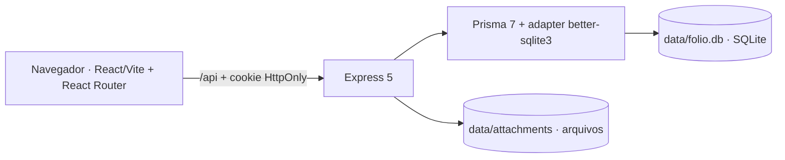

# SoftProtocolo — Fólio

Aplicação web em português do Brasil para registrar, numerar, localizar e acompanhar documentos administrativos. O frontend React consome uma API Express; os dados relacionais ficam no SQLite e os anexos, em uma hierarquia de arquivos administrada pelo backend.

## Comece por aqui

| Necessidade | Documento |
|---|---|
| Instalar, configurar e executar pela primeira vez | [Instalação e início rápido](docs/getting-started.md) |
| Entender componentes, sessão, RBAC e rotas do frontend | [Arquitetura e segurança](docs/architecture.md) |
| Entender entidades, migrations, seed e numeração | [Banco de dados e numeração](docs/database.md) |
| Integrar ou manter endpoints HTTP | [Referência da API](docs/api.md) |
| Alterar código, criar rotas e executar testes | [Desenvolvimento e testes](docs/development.md) |
| Publicar, administrar usuários, fazer backup e diagnosticar | [Operação, backup e diagnóstico](docs/operations.md) |

## Requisitos essenciais

- Node.js 22 (`>=22.13 <23`; a versão de referência está em `.nvmrc`).
- npm com suporte a `npm ci`.
- Não é necessário instalar servidor de banco: o SQLite é local.

Para preparar uma instalação nova, siga os comandos na ordem apresentada no [guia de início rápido](docs/getting-started.md). Não há credenciais padrão versionadas; o primeiro administrador é criado a partir do arquivo `.env` local.

## Visão rápida

Em desenvolvimento, `npm run dev` inicia frontend e backend. Em produção, o Express serve tanto a API quanto o frontend compilado.

O frontend possui URLs navegáveis, incluindo `/inicio`, `/documentos`, `/documentos/novo` e `/documentos/:documentId`. Atualização da página e acesso direto são atendidos pelo fallback da SPA no Express.

## Estado do projeto

- Sessão HTTP real com perfis `ADMIN`, `OPERATOR` e `VIEWER`.
- Numeração atômica por tipo e ano, sem reaproveitamento após cancelamento.
- Anexos validados e armazenados em `data/attachments/AAAA/MM/<documento>/<identificador>/<nome-original>`.
- URLs por página, retorno pós-login, títulos contextuais e guardas visuais por perfil.
- Migrations, seed idempotente, testes Vitest/Supertest e build Vite.
- O antigo armazenamento funcional em `localStorage` é removido uma única vez pelo frontend e não é importado.

Repositório remoto: [TersanPlay/solid-memory](https://github.com/TersanPlay/solid-memory).
