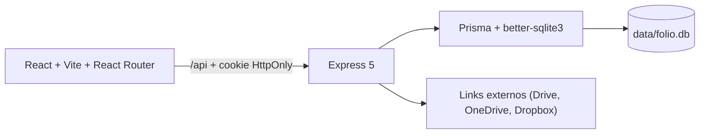

# MemoryDoc

Sistema web para registrar, numerar, localizar e acompanhar documentos administrativos. A aplicação usa React/Vite no frontend, Express na API, Prisma com SQLite para os dados relacionais e o filesystem para armazenar anexos.

Este README é a porta de entrada do projeto: apresenta os módulos disponíveis, explica o fluxo principal e mostra como instalar e executar uma cópia local.

## O que o sistema oferece

| Módulo | Funcionalidades disponíveis |
|---|---|
| Painel inicial | Indicadores do acervo, documentos recentes, distribuição por status e próxima sequência disponível. |
| Documentos | Consulta paginada, busca por protocolo/assunto/origem, filtros por tipo/status/ano e abertura do detalhe do documento. |
| Cadastro de documentos | Criação de protocolos com numeração atômica por tipo e ano, origem, destino, responsável, status e link documental externo. |
| Detalhe do documento | Alteração de status, histórico de movimentações, cancelamento terminal e informações de autoria. |
| Anexos | Upload, download e remoção de PDF, DOCX, XLSX, JPEG e PNG, com limite de 10 MB e validação de assinatura. |
| Departamentos | Cadastro, edição, ativação/desativação e exclusão quando não há vínculos documentais. |
| Tipos documentais | Cadastro e manutenção de tipos, prefixos, quantidade de dígitos e status ativo. |
| Usuários | Listagem, criação, edição, ativação/desativação e redefinição de senha. |
| Relatórios | Exportação dos documentos filtrados em CSV ou JSON. |
| Atividades | Histórico global de movimentações e ações do sistema. |

## Perfis e acesso

- `admin`: perfil administrativo interno; aparece como **Admin** na interface e pode gerenciar usuários, tipos, departamentos e relatórios.
- `OPERATOR`: pode criar documentos e alterar documentos próprios, conforme as regras do fluxo.
- `VIEWER`: possui acesso somente para consulta.

A autorização é aplicada no backend e também refletida visualmente no frontend. O último administrador ativo não pode ser desativado nem rebaixado. O primeiro administrador é criado pelo seed a partir das variáveis `BOOTSTRAP_ADMIN_*`.

## Módulos e rotas principais

| URL | Página | Acesso |
|---|---|---|
| `/inicio` | Painel administrativo | Qualquer sessão |
| `/documentos` | Acervo, busca e filtros | Qualquer sessão |
| `/documentos/novo` | Novo documento | `admin` ou `OPERATOR` |
| `/documentos/:documentId` | Detalhes do documento | Qualquer sessão |
| `/departamentos` | Departamentos | `admin` |
| `/tipos` | Tipos documentais | `admin` |
| `/usuarios` | Usuários | `admin` |
| `/relatorios` | Exportações | `admin` |
| `/atividades` | Histórico global | Qualquer sessão |

O detalhe do documento é uma rota filha de `/documentos`, portanto a lista permanece montada enquanto o drawer de detalhes está aberto. Atualização ou acesso direto a uma rota profunda é suportado pelo fallback da SPA em produção.

## Arquitetura resumida



- `src/`: telas, componentes, rotas, estilos e cliente HTTP.
- `server/`: Express, autenticação, autorização, regras documentais e API.
- `prisma/`: schema, migrations e seed.
- `scripts/`: CLI de usuários e manutenção do banco.
- `docs/`: documentação operacional e técnica detalhada.

Em desenvolvimento, o Vite atende `127.0.0.1:5173` e encaminha `/api` para a API em `3000`. Em produção, o Express atende a API e o frontend compilado no mesmo processo.

## Instalação local

### Requisitos

- Node.js 22, na faixa `>=22.13.0 <23`.
- npm.
- Git.
- Windows PowerShell, Linux ou macOS.

Não é necessário instalar um servidor de banco: o projeto usa SQLite local.

### Instalação do zero

```powershell
git clone https://github.com/TersanPlay/solid-memory.git MemoryDoc
cd MemoryDoc
npm ci
Copy-Item .env.example .env
```

Em Linux/macOS, use `cp .env.example .env` no lugar de `Copy-Item`.

Abra `.env` e defina uma senha forte e exclusiva para o administrador. O arquivo `.env` não deve ser versionado nem compartilhado. A configuração mínima é:

```dotenv
DATABASE_URL="file:./data/folio.db"
PORT=3000
API_PORT=3000
NODE_ENV=development
BOOTSTRAP_ADMIN_NAME="Administrador do sistema"
BOOTSTRAP_ADMIN_EMAIL="admin@example.invalid"
BOOTSTRAP_ADMIN_PASSWORD="defina-uma-senha-com-ao-menos-10-caracteres"
SEED_DEMO_DATA=false
```

Depois, execute na raiz do projeto:

```powershell
npm run db:generate
npm run db:migrate
npm run db:seed
npm run dev
```

Abra [http://127.0.0.1:5173/login](http://127.0.0.1:5173/login) e use o e-mail e a senha definidos no `.env`.

O seed é idempotente: cria os catálogos quando as tabelas estão vazias e cria ou regulariza o administrador de bootstrap. Ele não redefine a senha de um usuário já existente. Para criar dados demonstrativos sanitizados, defina `SEED_DEMO_DATA=true` antes de executar `npm run db:seed`.

### Executar frontend e API separadamente

```powershell
# Terminal 1
npm run dev:api

# Terminal 2
npm run dev:web
```

Se alterar a porta da API, mantenha `PORT` e `API_PORT` com o mesmo valor no terminal atual:

```powershell
$env:PORT='3101'
$env:API_PORT='3101'
npm run dev
```

### Verificar a instalação

```powershell
npm test
npm run build
# ou, em um único comando:
npm run verify
```

O healthcheck da API fica disponível em [http://127.0.0.1:3000/api/health](http://127.0.0.1:3000/api/health).

## Comandos disponíveis

| Comando | Finalidade |
|---|---|
| `npm run dev` | Inicia Vite e API em paralelo. |
| `npm run dev:web` | Inicia somente o frontend em `5173`. |
| `npm run dev:api` | Inicia somente a API com recarga automática. |
| `npm run build` | Compila o frontend em `dist/`. |
| `npm start` | Executa o Express; em produção também serve `dist/`. |
| `npm run db:generate` | Regenera o cliente Prisma. |
| `npm run db:migrate` | Cria/aplica migrations em desenvolvimento. |
| `npm run db:deploy` | Aplica migrations versionadas, indicado para produção. |
| `npm run db:seed` | Inicializa catálogos e garante o administrador de bootstrap. |
| `npm run users -- help` | Exibe a CLI administrativa de usuários. |
| `npm run users -- list` | Lista usuários sem expor hashes ou salts. |
| `npm test` | Executa a suíte Vitest. |
| `npm run verify` | Executa testes e build. |

## Produção e Railway

Para uma instalação tradicional:

```powershell
npm ci
npm run db:generate
npm run build
npm run db:deploy
npm run db:seed
$env:NODE_ENV='production'
npm start
```

Use HTTPS em produção e mantenha o SQLite em armazenamento persistente. O MemoryDoc não recebe, grava ou serve arquivos: os documentos ficam no serviço externo indicado pelo link HTTPS.

O projeto também contém configuração para Railway:

- build: `npm run build:railway`;
- start: `npm run start:railway`;
- healthcheck: `/api/health`;
- volume recomendado: `/app/data`.

Consulte [docs/railway.md](docs/railway.md) antes de publicar.

## Documentação detalhada

| Assunto | Documento |
|---|---|
| Instalação, configuração e diagnóstico | [docs/getting-started.md](docs/getting-started.md) |
| Arquitetura, sessão, RBAC e rotas | [docs/architecture.md](docs/architecture.md) |
| Entidades, migrations, seed e numeração | [docs/database.md](docs/database.md) |
| Endpoints HTTP e contratos | [docs/api.md](docs/api.md) |
| Estrutura, testes e contribuição técnica | [docs/development.md](docs/development.md) |
| Operação, backup, usuários e troubleshooting | [docs/operations.md](docs/operations.md) |
| Deploy com SQLite no Railway | [docs/railway.md](docs/railway.md) |

## Problemas comuns

- **Tela em branco:** verifique o console do navegador e confirme que o frontend e a API foram iniciados pelo mesmo `npm run dev`.
- **`EADDRINUSE`:** há outro processo usando `3000` ou `5173`; encerre somente o processo conhecido ou configure portas livres e iguais para `PORT`/`API_PORT`.
- **Erro de migration:** execute `npm run db:deploy` em uma base existente; em desenvolvimento, use `npm run db:migrate`.
- **Login recusado:** confirme as variáveis `BOOTSTRAP_ADMIN_*`, execute `npm run db:seed` e verifique se o usuário está ativo.
- **Link indisponível:** confirme se a URL HTTPS ainda é válida e se o compartilhamento no serviço externo permite o acesso dos usuários autorizados.
- **Erro do Prisma Client:** execute `npm run db:generate`.

## Estado e limites conhecidos

- O sistema foi projetado para uma única instância da API e um arquivo SQLite local.
- A escala horizontal não está implementada.
- A senha existente do administrador não é redefinida automaticamente pelo seed.
- O banco preserva os metadados e links documentais; o conteúdo permanece sob responsabilidade do serviço externo referenciado.

## Repositório

[TersanPlay/solid-memory](https://github.com/TersanPlay/solid-memory)
