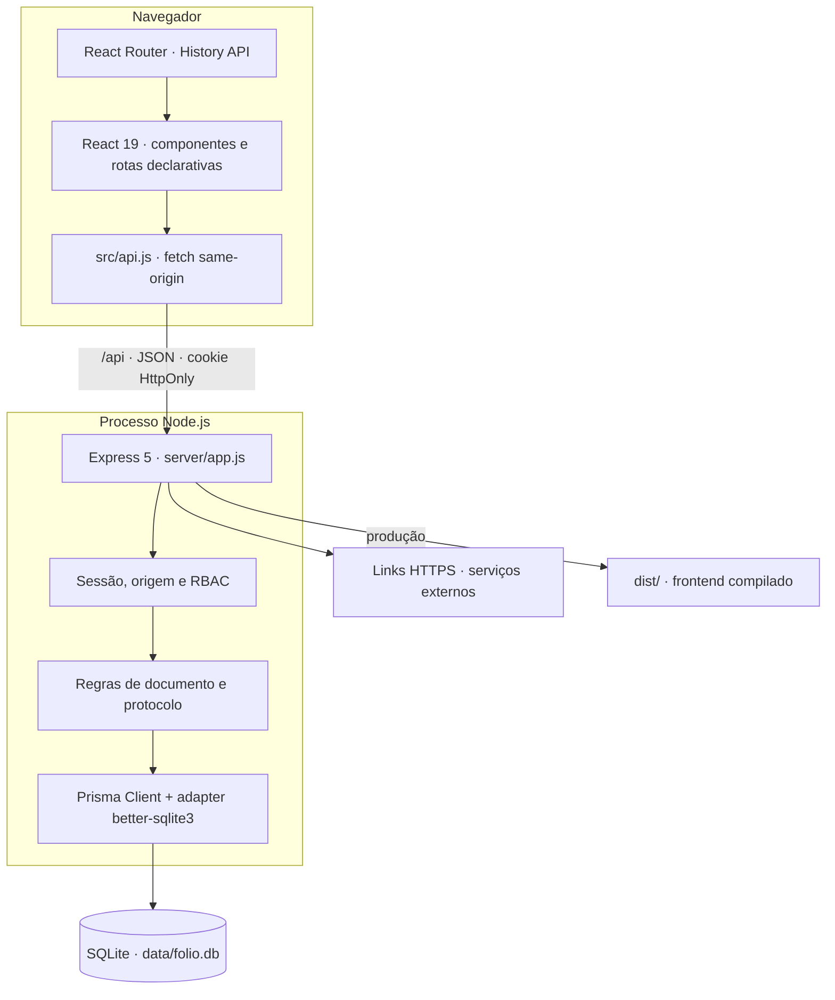
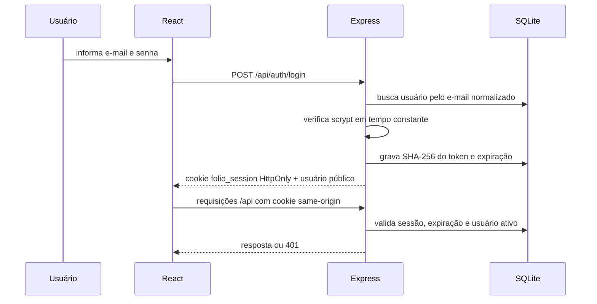
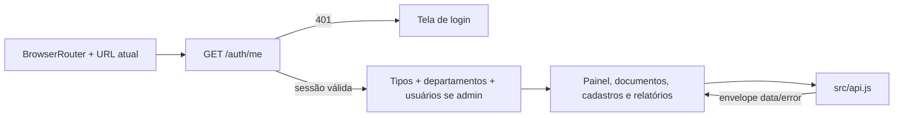

# Arquitetura e segurança

## Componentes

O frontend e o backend compartilham o mesmo `package.json`, mas mantêm responsabilidades separadas:

- `src/`: apresentação, roteamento declarativo, formulários e cliente HTTP;
- `server/app.js`: composição do Express, validações Zod e rotas;
- `server/auth.js`: hash de senha, tokens, cookies e perfis;
- `server/documents.js`: filtros, numeração, permissões por documento e histórico;
- Links documentais são apenas referências HTTPS; o conteúdo permanece no serviço externo;
- `server/attachment-migration.js`: migração em lotes dos `BLOBs` legados;
- `server/db.js`: adapter Prisma e pragmas SQLite;
- `prisma/`: schema, migration e seed.

`server/index.js` é o único módulo que abre uma porta. Os testes importam `createApp` sem iniciar servidor real.

## Stack confirmada

| Camada | Tecnologia/versão fixada | Responsabilidade |
|---|---|---|
| Interface | React `19.2.8`, React DOM `19.2.8` | Componentes e estado local de formulários/listas. |
| Navegação | React Router `7.18.1` | History API, links, rotas, retorno pós-login e parâmetros de URL. |
| Build e desenvolvimento | Vite `8.1.5` | Servidor web em `127.0.0.1:5173`, proxy `/api` e build `dist/`. |
| API | Express `5.2.1`, Zod `4.4.3` | HTTP, validação, autenticação, RBAC e respostas. |
| Persistência | Prisma `7.9.0` e adapter `better-sqlite3` | Dados relacionais e metadados dos links no SQLite; arquivos fora da aplicação. |
| Testes | Vitest `4.1.10`, Testing Library, Supertest | Testes unitários, DOM, CLI, API e fallback SPA. |

As versões completas e autoritativas estão no `package.json` e no `package-lock.json`.

## Fluxo de sessão

- O token aleatório possui 32 bytes; somente seu SHA-256 é persistido.
- A sessão expira oito horas após o login; não há renovação automática da expiração.
- O cookie usa `HttpOnly`, `SameSite=Lax`, `Path=/` e `Secure` em produção.
- Logout remove a sessão do banco e expira o cookie.
- Alterar uma senha ou desativar um usuário remove suas sessões.
- Senhas usam `crypto.scrypt`, salt aleatório e comparação em tempo constante.

## Perfis e autorização

| Capacidade                               |                admin                |                    OPERATOR                     | VIEWER |
| ---------------------------------------- | :---------------------------------: | :---------------------------------------------: | :----: |
| Consultar documentos, histórico e links  |                 Sim                 |                       Sim                       |  Sim   |
| Criar documento                          |                 Sim                 |                       Sim                       |  Não   |
| Definir outro responsável                |                 Sim                 |     Não; o servidor força o próprio usuário     |  Não   |
| Alterar documento não cancelado          |              Qualquer               |         Apenas documento criado por si          |  Não   |
| Adicionar ou remover link                | Em qualquer documento não cancelado | Apenas em documento não cancelado criado por si |  Não   |
| Cancelar documento                       |                 Sim                 |                       Não                       |  Não   |
| Manter usuários, tipos e departamentos   |                 Sim                 |                       Não                       |  Não   |
| Exportar relatórios                      |                 Sim                 |                       Não                       |  Não   |

O frontend oculta ações incompatíveis, mas toda decisão é repetida no backend. Um documento cancelado é terminal inclusive para administradores.

O último administrador ativo não pode ser desativado nem receber outro perfil.

Administradores podem editar nome e código de departamentos. A exclusão física é restrita a departamentos sem vínculos de origem ou destino; cadastros usados permanecem editáveis e podem ser desativados.

## Limites de confiança

- Todas as entradas JSON passam por Zod antes de alcançar a regra de negócio.
- Mutações com cabeçalho `Origin` são aceitas apenas para o host esperado em produção. No desenvolvimento, somente origens de loopback são adicionais.
- Helmet envia cabeçalhos defensivos; não existe CORS aberto.
- Login é limitado a cinco tentativas em quinze minutos por endereço IP, usando a chave padrão do rate limiter.
- Pino registra método, URL, status, duração e request ID; cookies e autorização são ocultados e o corpo não é incluído.
- Toda resposta contém `X-Request-Id`; erros internos não devolvem stack trace.
- CSV protege células iniciadas por `=`, `+`, `-` ou `@` contra execução de fórmula.
- Links documentais aceitam somente URLs HTTPS e são classificados pelo provedor.
- O caminho persistido é relativo à raiz autorizada e nunca deriva diretamente de um caminho informado pelo navegador.
- O nome original é preservado no banco e no arquivo quando compatível com o sistema operacional; caracteres de controle, separadores e nomes reservados são neutralizados somente no nome físico.
- A remoção apaga o arquivo, mas preserva metadados e autoria em `DocumentHistory`; documentos cancelados permanecem terminais.

## Fluxo de dados do frontend

Na inicialização, as antigas chaves `folio-session`, `folio-documents`, `folio-types` e `folio-departments` são removidas. Nenhuma regra funcional usa `localStorage`.

Os controles de seleção usam Radix com menus compactos para enums e `cmdk` para busca em catálogos dinâmicos. Datas usam React DayPicker em pt-BR, mas permanecem strings `YYYY-MM-DD` na comunicação com a API para evitar deslocamentos de fuso.

## Roteamento do frontend

O navegador é a fonte de verdade da página atual. A aplicação usa `BrowserRouter`, links semânticos e a History API; não mantém uma página paralela em estado React.

| URL | Página | Acesso |
|---|---|---|
| `/login` | Autenticação | Pública |
| `/inicio` | Painel | Qualquer sessão |
| `/documentos` | Acervo e filtros | Qualquer sessão |
| `/documentos/novo` | Novo registro | `admin` ou `OPERATOR` |
| `/documentos/:documentId` | Drawer de detalhes | Qualquer sessão |
| `/departamentos`, `/tipos`, `/usuarios`, `/relatorios` | Administração | `admin` |
| `/atividades` | Histórico global | Qualquer sessão |

Ao receber `401`, uma URL protegida redireciona para `/login` e é preservada como destino de retorno. Depois do login, o usuário volta ao endereço solicitado. Rotas sem permissão exibem uma página interna de acesso negado sem substituir a autorização do backend.

O detalhe de documento é uma rota filha do acervo. Isso mantém lista, filtros e posição de rolagem montados enquanto o drawer está aberto. Acesso direto ou atualização em `/documentos/:documentId` consulta `GET /api/documents/:id`; fechar um link direto usa `/documentos` como retorno seguro.

Em produção, o Express entrega `dist/index.html` para qualquer `GET` que não comece com `/api/`. Assim, atualizar ou abrir diretamente uma rota do frontend não produz 404 no servidor.

Os guardas do frontend evitam apresentar páginas incompatíveis com o perfil, mas não concedem autorização. Toda leitura ou mutação protegida continua dependendo da sessão e das verificações do Express.

## Execução

- Desenvolvimento: Vite serve o frontend e encaminha `/api` para a porta definida por `API_PORT` ou 3000.
- Produção: `npm run build` cria `dist/`; Express serve os arquivos e a API no mesmo processo/host.
- O serviço externo referenciado é responsável pela disponibilidade e pelas permissões do conteúdo.
- O Express escuta em `0.0.0.0` na porta definida por `PORT`; localmente, o navegador continua acessando `127.0.0.1`.
- No Railway, `railway.json` força o processo Express completo, evitando que a detecção do Vite publique apenas os arquivos estáticos.
- O volume Railway deve ser montado em `/app/data`; migrations e seed são executados no comando de inicialização, quando o volume já está disponível.
- O projeto foi desenhado para uma única instância da API e um arquivo SQLite local. Escala horizontal não está implementada.
