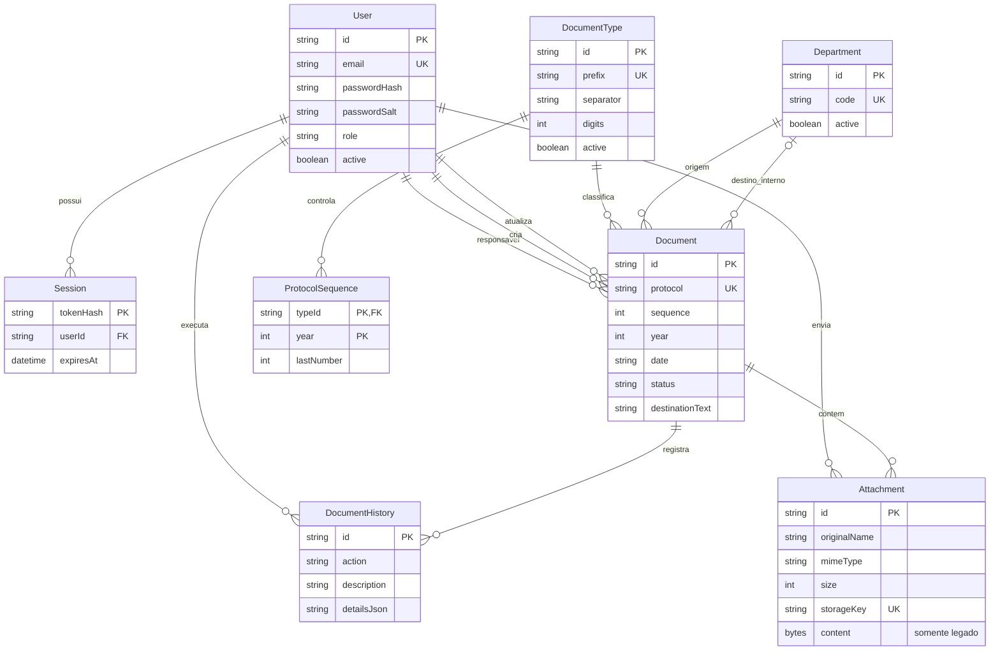
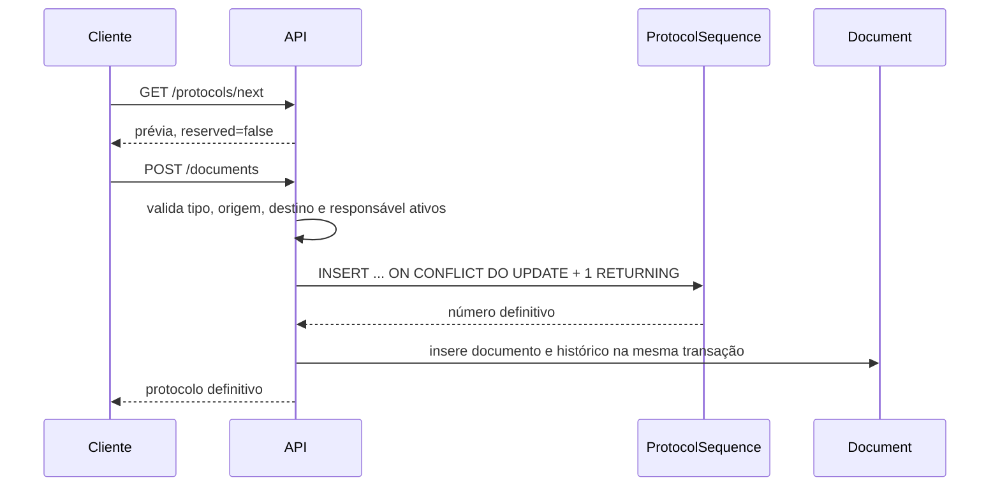

# Banco de dados e numeração

## Configuração

O datasource é SQLite e seu endereço vem exclusivamente de `DATABASE_URL`. O valor local recomendado é:

```dotenv
DATABASE_URL="file:./data/folio.db"
ATTACHMENTS_DIR="./data/attachments"
```

`server/prepare-database.js` cria o diretório e o arquivo vazio quando necessário. `prisma.config.ts` converte o caminho relativo em absoluto para o engine de migrations no Windows. Na inicialização, o backend aplica:

```sql
PRAGMA foreign_keys = ON;
PRAGMA journal_mode = WAL;
PRAGMA busy_timeout = 5000;
```

## Entidades



## Regras persistidas

- `User.email`, `DocumentType.prefix`, `Department.code` e `Document.protocol` são únicos.
- A combinação `(typeId, year, sequence)` também é única.
- `ProtocolSequence` usa `(typeId, year)` como chave primária.
- Perfis, status e ações de histórico possuem `CHECK`; a migration `20260722163000_attachment_remove_history` acrescenta `ATTACHMENT_REMOVE` sem reescrever a migration inicial.
- Separador aceita `/` ou `-`; a máscara aceita de 3 a 6 dígitos.
- Um documento deve ter exatamente um destino: `destinationDepartmentId` ou `destinationText`.
- Foreign keys impedem excluir referências usadas. A aplicação não oferece exclusão física desses cadastros.
- `Attachment.storageKey` é único e relativo a `ATTACHMENTS_DIR`; `content` permanece opcional apenas para leitura e migração de `BLOBs` legados.
- A constraint `Attachment_storage_check` exige exatamente uma origem de conteúdo: arquivo ou `BLOB` legado.
- A remoção apaga a linha e o arquivo, mas grava antes os metadados no `detailsJson` de `DocumentHistory`.

A data de emissão é uma string `YYYY-MM-DD`, evitando alteração de dia por fuso horário. Timestamps técnicos usam `DateTime`/ISO 8601.

Documentos guardam snapshots de código e nome da origem/destino. Renomear um departamento não altera o percurso histórico já emitido.

### Ciclo de vida

- Usuários, tipos, departamentos e documentos não possuem endpoint de exclusão; são desativados ou mantidos para preservar referências.
- Sessões expiradas são removidas na inicialização e também durante o login.
- Documentos cancelados permanecem no banco e não podem voltar a outro status.
- Anexos são a exceção: podem ser excluídos fisicamente para liberar o arquivo, mantendo metadados e autoria no histórico.
- Relações Prisma usam `Restrict` nas referências funcionais. Cascatas existem para sessões do usuário e para histórico/anexos caso um documento fosse removido diretamente do banco; esse fluxo não é oferecido pela aplicação.

## Organização dos anexos

O backend grava novos arquivos com a seguinte chave relativa:

```text
AAAA/MM/<documentId>/<storageId>/<nome-original-seguro>
```

Exemplo:

```text
2026/07/cmrwg7bcz00032gw65seuprw2/550e8400-e29b-41d4-a716-446655440000/Relatório final.pdf
```

- `AAAA/MM` usa a data técnica do upload em UTC e distribui o volume ao longo do tempo.
- `documentId` agrupa anexos do mesmo documento.
- `storageId` é aleatório e impede colisão quando nomes se repetem.
- O último segmento preserva o nome original sempre que ele é válido no filesystem. Separadores, controles, caracteres incompatíveis no Windows e nomes reservados como `CON` são substituídos somente no nome físico.
- `originalName` continua preservado no SQLite para apresentação, auditoria e `Content-Disposition`.
- O banco guarda somente a chave relativa, nunca um caminho absoluto controlado pelo cliente.

Anexos criados antes desta mudança continuam disponíveis pelo campo `content`. Com a aplicação parada, `npm run attachments:migrate` processa esses registros em lotes de 50, grava cada arquivo primeiro e somente então troca o `BLOB` pela `storageKey`. Uma falha remove o arquivo incompleto e mantém o registro legado.

## Emissão do protocolo

Formato implementado:

```text
PREFIXO-NÚMERO_PREENCHIDO{SEPARADOR}ANO
MEMO-014/2026
LT-005-2026
```



- A prévia não grava nem reserva número.
- Ano vem dos quatro primeiros caracteres da data de emissão.
- Cada tipo/ano começa em 1 e avança atomicamente.
- Em `SQLITE_BUSY`, a criação tenta novamente uma vez após uma espera curta; a segunda falha retorna conflito controlado.
- Cancelamento grava histórico, define `cancelledAt`, mantém a linha e nunca decrementa a sequência.

## Migrations

Migrations versionadas atualmente:

| Diretório | Alteração |
|---|---|
| `20260722130000_init` | Cria entidades, índices, chaves estrangeiras e constraints iniciais. |
| `20260722163000_attachment_remove_history` | Atualiza o `CHECK` de `HistoryAction` para permitir `ATTACHMENT_REMOVE`. |
| `20260722203000_attachment_filesystem_storage` | Adiciona `storageKey`, torna o `BLOB` opcional e exige uma única origem de conteúdo. |

| Contexto                          | Comando                                          | Uso                                                      |
| --------------------------------- | ------------------------------------------------ | -------------------------------------------------------- |
| Alterar schema em desenvolvimento | `npm run db:migrate -- --name nome_da_alteracao` | Gera e aplica uma migration.                             |
| Gerar cliente                     | `npm run db:generate`                            | Necessário após alterar o schema.                        |
| Aplicar em produção               | `npm run db:deploy`                              | Aplica somente migrations existentes.                    |
| Migrar anexos legados             | `npm run attachments:migrate`                    | Move `BLOBs` existentes para `ATTACHMENTS_DIR`.           |
| Inspecionar localmente            | `npm run db:studio`                              | Abre Prisma Studio. Não exponha essa porta publicamente. |

O Prisma 7 não executa automaticamente seed nem geração do cliente após `migrate dev`; mantenha os comandos explícitos.

Os testes integrados aplicam todos os arquivos `migration.sql` em ordem lexicográfica sobre um SQLite temporário. Novas migrations devem permanecer em diretórios timestampados para preservar essa ordem.

## Seed

`npm run db:seed` faz upsert de:

- Memorando, Ofício, Circular, Comunicado Interno, Ordem de Serviço, Laudo Técnico e Parecer Técnico;
- Departamento de Arquivo, Almoxarifado, Tecnologia da Informação, Gestão de Pessoas, Financeiro e Patrimônio/Manutenção;
- administrador definido pelas variáveis `BOOTSTRAP_ADMIN_*`.

O seed é idempotente e não redefine a senha de usuário existente. Quando `SEED_DEMO_DATA=true` e ainda não há documentos, cria dois registros sanitizados, usando o administrador como responsável e sem anexos.

As variáveis `BOOTSTRAP_ADMIN_NAME`, `BOOTSTRAP_ADMIN_EMAIL` e `BOOTSTRAP_ADMIN_PASSWORD` são validadas em toda execução do seed. Se o e-mail já existir, o seed atualiza o nome, restaura o perfil `ADMIN` e reativa o usuário, mas preserva o hash e o salt da senha existente.
